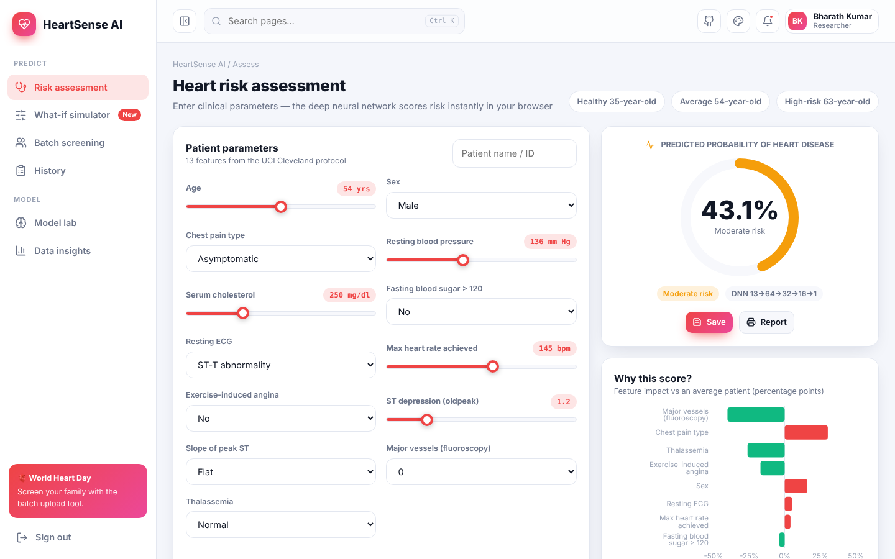
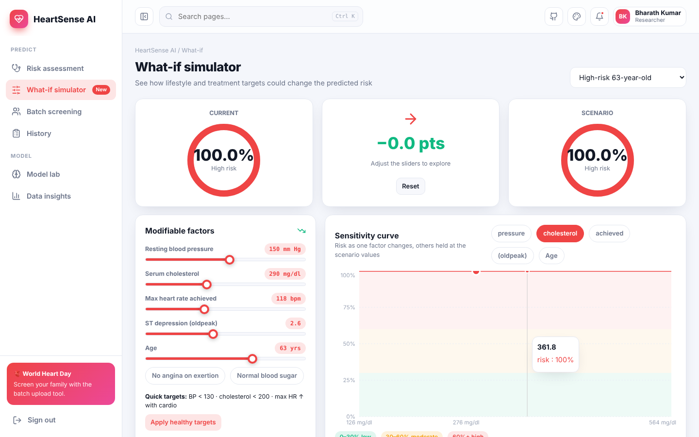
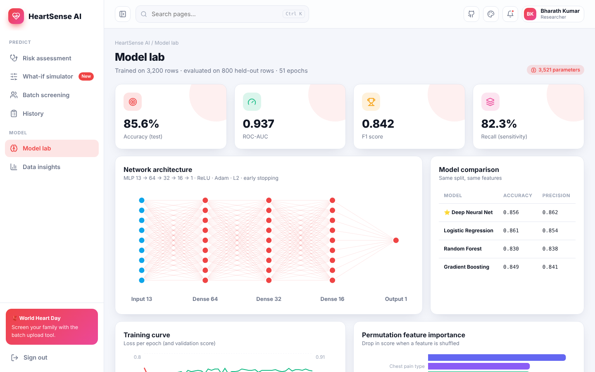
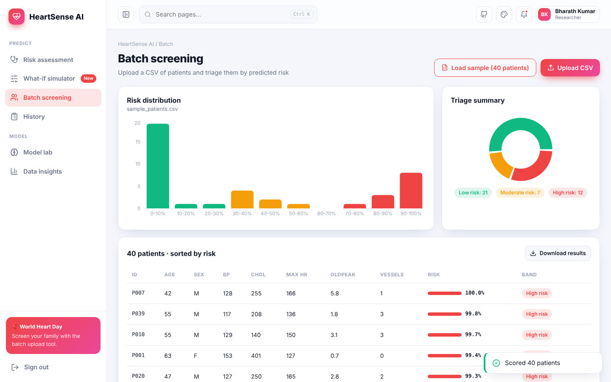

<div align="center">

# ❤️ HeartSense AI — Heart Disease Risk Prediction

**A deep neural network (MLP 13 → 64 → 32 → 16 → 1) that predicts heart-disease risk from 13 clinical features — running entirely in the browser with explainable AI, a what-if simulator, batch screening and a full model lab.**

[](https://preciousbharath.github.io/HEARTSENSE-AI-HEART-DISEASE-PREDICTION/)


### 🔗 [preciousbharath.github.io/HEARTSENSE-AI-HEART-DISEASE-PREDICTION](https://preciousbharath.github.io/HEARTSENSE-AI-HEART-DISEASE-PREDICTION/)
Demo login → **demo@heartsense.app** / **Demo@1234**

</div>

---

## 📊 Results (held-out test set, 800 patients)

| Model | Accuracy | Precision | Recall | F1 | ROC-AUC |
|---|---|---|---|---|---|
| ⭐ **Deep Neural Net (deployed)** | **0.856** | 0.862 | 0.823 | 0.842 | **0.936** |
| Logistic Regression | 0.861 | 0.854 | 0.847 | 0.851 | 0.929 |
| Random Forest | 0.830 | 0.838 | 0.788 | 0.812 | 0.928 |
| Gradient Boosting | 0.849 | 0.841 | 0.834 | 0.837 | 0.938 |

## ✨ Features

| Page | What it does |
|---|---|
| 🔐 **Register / Login** | Animated auth, roles (Doctor, Nurse, Student, Researcher, Patient), hashed passwords, demo account |
| 🩺 **Risk assessment** | 13 clinical inputs with presets → probability gauge, Low/Moderate/High band, **feature-impact explanation**, personalised recommendations, save & print |
| 🎚️ **What-if simulator** | Change BP, cholesterol, max heart rate, ST depression… and watch risk move; sensitivity curve with risk zones; one-click "healthy targets" |
| 👥 **Batch screening** | Upload a CSV (or the 40-patient sample) → triage table sorted by risk, distribution histogram, band donut, download scored CSV |
| 🗂️ **History** | Saved assessments with a risk timeline |
| 🧠 **Model lab** | Architecture diagram, model comparison, training curve, permutation importance, ROC curve, confusion matrix, calibration plot |
| 📈 **Data insights** | Disease rate by age, chest-pain type, vessels and thalassemia; correlation chart; age vs max-HR bubble plot |
| 🎨 **Themes** | 5 themes × 6 accents, animation toggle, responsive |

## 🧠 How it works

```
ml/train.py  ──►  simulate Cleveland-style data (4,000 patients, 13 features)
             ──►  StandardScaler + MLPClassifier(64, 32, 16, ReLU, Adam, L2, early stopping)
             ──►  baselines: Logistic Regression · Random Forest · Gradient Boosting
             ──►  metrics, ROC, calibration, permutation importance
             ──►  export weights → src/model/model.json (≈45 KB)

browser      ──►  src/core/nn.js runs the forward pass (matrix multiply + ReLU + sigmoid) in < 5 ms
             ──►  explanations: occlusion attribution (feature → dataset mean, Δ probability)
```

Retrain any time:

```bash
cd ml
pip install -r requirements.txt
python train.py          # writes ../src/model/model.json and ../public/sample_patients.csv
```

## 🖼️ Screenshots

| Risk assessment | What-if simulator |
|---|---|
|  |  |
| **Model lab** | **Batch screening** |
|  |  |

## 🚀 Run the web app

```bash
git clone https://github.com/PreciousBharath/HEARTSENSE-AI-HEART-DISEASE-PREDICTION.git
cd HEARTSENSE-AI-HEART-DISEASE-PREDICTION
npm install && npm run dev
```

## 📁 Structure

```
ml/                 # Python training pipeline (scikit-learn) + generated dataset
src/model/          # exported network weights & metrics
src/core/nn.js      # JS inference engine + explanation
src/pages/          # Assess, WhatIf, Batch, History, Lab, Insights
```

> ⚕️ Educational project only — not a medical device. The model is trained on simulated data modelled on the UCI Cleveland feature set.

## 👨‍💻 Author

**Bharath** — AI/ML Trainer · Software Developer · Madurai  
[GitHub](https://github.com/PreciousBharath) · [LinkedIn](https://linkedin.com/in/connectbharath) · [Portfolio](https://itsbharathportfolio.netlify.app)
